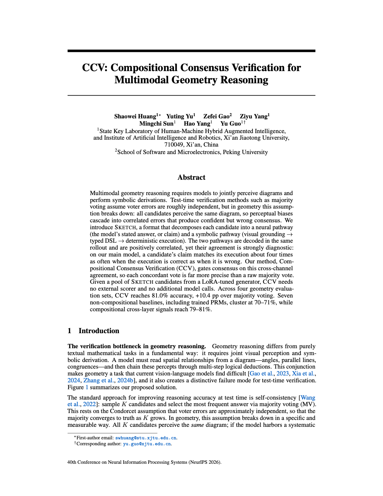

# CCV: Compositional Consensus Verification for Multimodal Geometry Reasoning
🎉🎉🎉 **Our paper has been accepted at NeurIPS 2026!**

Official code repository for **CCV: Compositional Consensus Verification for Multimodal Geometry Reasoning**.

> [!NOTE]
> **Code coming soon.** This repository is currently a placeholder for the paper's code release. Source code, model checkpoints, and data are **not** available yet.

## Paper

📄 [Read the full camera-ready paper (PDF)](CCV_NeurIPS2026.pdf) — opens in GitHub's built-in PDF viewer.

*CCV: Compositional Consensus Verification for Multimodal Geometry Reasoning.* BibTeX citation will be added once the final publication metadata is available.

## Release plan

| Component | Status |
| --- | --- |
| Core CCV implementation | Coming soon |
| Training and inference scripts, configs | Coming soon |
| Evaluation on multimodal geometry reasoning benchmarks | Coming soon |
| Pre-trained checkpoints | Coming soon |
| Installation and reproduction guide | Coming soon |

This table is updated and a release is tagged as each component becomes publicly available. Click **Watch** on this repository to be notified.

## Questions

Please use the repository's **Issues** tab for release questions and requests, so the current status stays visible to everyone.

## License

To be specified together with the initial code release.
