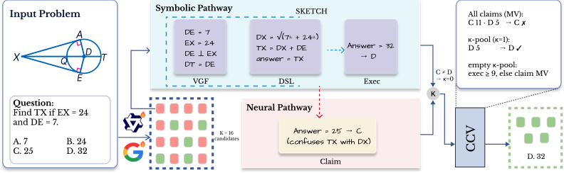
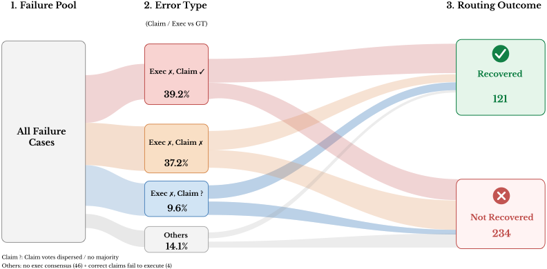

# CCV: Compositional Consensus Verification for Multimodal Geometry Reasoning
🎉🎉🎉 **Our paper has been accepted at NeurIPS 2026!**

Official code repository for **CCV: Compositional Consensus Verification for Multimodal Geometry Reasoning**.

> [!NOTE]
> **Code coming soon.** This repository is currently a placeholder for the paper's code release. Source code, model checkpoints, and data are **not** available yet.

## Paper

📄 [Read the full camera-ready paper (PDF)](CCV_NeurIPS2026.pdf) — opens in GitHub's built-in PDF viewer.

*CCV: Compositional Consensus Verification for Multimodal Geometry Reasoning.* BibTeX citation will be added once the final publication metadata is available.

## Overview

Multimodal geometry reasoning requires models to jointly perceive diagrams and perform symbolic derivations. Test-time verification methods such as majority voting assume voter errors are roughly independent, but in geometry this assumption breaks down: all candidates perceive the same diagram, so perceptual biases cascade into correlated errors that produce confident but wrong consensus. We introduce SKETCH, a format that decomposes each candidate into a neural pathway (the model's stated answer, or claim) and a symbolic pathway (visual grounding → typed DSL → deterministic execution). The two pathways are decoded in the same rollout and are positively correlated, yet their agreement is strongly diagnostic: on our main model, a candidate's claim matches its execution about four times as often when the execution is correct as when it is wrong. Our method, Compositional Consensus Verification (CCV), gates consensus on this cross-channel agreement, so each concordant vote is far more precise than a raw majority vote. Given a pool of SKETCH candidates from a LoRA-tuned generator, CCV needs no external scorer and no additional model calls. Across four geometry evaluation sets, CCV reaches 81.0% accuracy, +10.4 pp over majority voting. Seven non-compositional baselines, including trained PRMs, cluster at 70–71%, while compositional cross-layer signals reach 79–81%.

*Figure 1: Method overview. Each of the K=16 candidates writes a SKETCH (visual grounding facts and a typed DSL program) and then states its answer (claim); an external interpreter executes the DSL (exec). The two pathways share the SKETCH and diverge only at the last step. In the expanded candidate, the claim (C) disagrees with the execution result (32 → D), so κ=0. Majority voting over all claims selects C (11/16) and is wrong; CCV keeps only the five κ-consistent candidates, which all answer D. If no candidate is κ-consistent, CCV falls back to an execution majority of at least τexec=9 votes, and otherwise to the claim majority*

*Figure E.1: Error flow and recovery. The 355 recoverable EAV failures split into a wrong execution consensus with a correct claim cluster of at least 8/16 (Exec✗Claim✓, 139), a wrong claim cluster (Exec✗Claim✗, 132) or dispersed claims (Exec✗Claim?, 34), and 50 other failures. CCV recovers 88, 14, 12 and 7 of these: 121 recoveries in total, equal to its gains over EAV in Table 4.*

## Release plan

| Component | Status |
| --- | --- |
| Core CCV implementation | Coming soon |
| Training and inference scripts, configs | Coming soon |
| Evaluation on multimodal geometry reasoning benchmarks | Coming soon |
| Pre-trained checkpoints | Coming soon |
| Installation and reproduction guide | Coming soon |

This table is updated and a release is tagged as each component becomes publicly available. Click **Watch** on this repository to be notified.

## Questions

Please use the repository's **Issues** tab for release questions and requests, so the current status stays visible to everyone.

## License

To be specified together with the initial code release.
